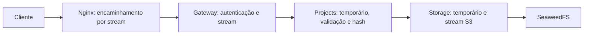

# RNF-EFIC-01 — Eficiência dos uploads

## Objetivo e critérios

Classificação: ISO/IEC 25010:2011, eficiência de desempenho, utilização de recursos, com controlo do comportamento temporal. A condição principal é o envio simultâneo do mesmo vídeo pequeno congelado por três clientes Premium, em projetos distintos.

Reduzir a mediana do pico adicional agregado de RSS em pelo menos **50%**, com alvo de **70%**. Admitir aumento máximo de **15%** na mediana do tempo até todas as respostas, com alvo de não aumentar. Preservar integridade, metadados, associação e contratos dos casos válidos do corpus. A meta adicional exige concluir os três vídeos grandes simultâneos em todas as dez repetições, com HTTP 204, versão e integridade, sem aumentar recursos ou timeouts. Os critérios estão em `acceptance.json`.

## Diagnóstico e referência

A solução de base retém ficheiros completos em memória nos serviços atravessados pelo upload. O encaminhamento HTTP também pode reter o corpo para repetir pedidos em redirecionamentos. Este custo cresce com o tamanho dos vídeos e a concorrência. A situação prejudica os utilizadores que enviam vídeos grandes e a capacidade operacional dos serviços.

A baseline utiliza o commit `052310226c51fa57a17101c7bd1ad795674aac95`, campanha `baseline-e3f5e6`, protocolo 4. O corpus exato é reutilizado: vídeo pequeno de 53.243.813 bytes, vídeo grande de 942.219.473 bytes e JPEG de 5.263.900 bytes; os SHA-256 estão no manifesto. Na condição principal, a referência é 977.83593750 MiB de RSS adicional e 1.476963745 s até todas as respostas. Os três vídeos grandes não tinham baseline de memória elegível: os trinta pedidos dessa condição terminaram em HTTP 504.

## Decisão arquitetural e refactoring

Mantém-se o protocolo multipart e a validação antes de associar o objeto ao projeto. Foram consideradas a receção integral em memória, o encaminhamento por streams e o envio direto do cliente ao S3. A opção aplicada preserva o contrato existente, evitando alterar a API pública e a responsabilidade de validação.

- O nginx encaminha o corpo durante a receção, com HTTP/1.1 e `proxy_request_buffering off`. O gateway encaminha o multipart original com controlo de fluxo, sem guardar outro ficheiro completo. Proprietário, partilha, identidade, MIME, nome e versão continuam a atravessar o pedido.
- O `projects` recebe num temporário restrito, valida o vídeo por FFprobe e calcula SHA-256 incrementalmente. O armazenamento recebe em temporário e envia o ficheiro por stream. Não se retém um Buffer proporcional ao ficheiro completo.
- Os ficheiros até 1 GiB seguem por um único PUT S3. Resultados internos maiores mantêm multipart com buffering limitado, sem introduzir um limite novo nesses produtores. Nos uploads aceites, evita-se o conjunto de pedidos e a preparação/conclusão de partes multipart.
- A manutenção do SeaweedFS recupera periodicamente o espaço marcado como apagado, evitando esgotar volumes de escrita por dados já eliminados. A política mantém o tamanho e a alocação dos volumes, a replicação e as tarefas de manutenção existentes; acrescenta compactação regular sem aumentar a capacidade ou os timeouts.
- Os transportes internos desativam a repetição de corpo em redirecionamentos. Cancelamento propaga-se a jusante; as streams e os temporários são fechados. Objetos conhecidos ainda não associados são compensados em conflito/cancelamento. Um resultado de commit incerto conserva o objeto para evitar referências quebradas.

A versão final pode ser reproduzida a partir de `c7e597a2674a74f6fc0f225145e74260ff23a61e` no `main` do repositório partilhado. O patch e os hashes do código permitem verificar a versão executada. Não há alteração de funcionalidades, perfis, quotas, limites, recursos ou timeouts. A configuração de transporte é parte do refactoring; o método de medição continua a ser o protocolo 4.

## Método e ambiente

Cinco condições, dez tentativas por condição e noventa pedidos HTTP por versão. Ordem: vídeo pequeno, vídeo grande, imagem, três vídeos pequenos e três vídeos grandes. Antes de cada tentativa, reiniciam-se apenas os três serviços observados, verifica-se readiness e faz-se o mesmo warm-up leve. A janela tem 30 s de repouso, o upload completo e 30 s após todas as respostas. O cliente envia blocos de 1 MiB e sincroniza os três pedidos numa barreira, com a ligação TLS preparada antes dela.

A cada 100 ms, observadores externos ao cgroup medem a soma do RSS dos processos dos três serviços, incluindo filhos como FFprobe. A agregação usa buckets comuns; não se somam picos independentes por serviço. O pico adicional subtrai a mediana agregada do repouso. Exigem-se zero buckets comuns em falta e gap máximo de 250 ms para aceitar uma janela de memória. RSS agregado não é memória física única: páginas partilhadas podem ser contadas várias vezes.

O mesmo host e corpus foram usados, com dependências/runtimes congelados. As imagens finais preservam as camadas base; os lockfiles instalados, o código efetivo nos containers, os limites e a configuração nginx foram conferidos (`runtime-equivalence.json`). A alteração de Compose monta a política de manutenção do armazenamento; o comando de capacidade, os limites de recursos e os timeouts coincidem com a base. As imagens auxiliares estão identificadas; para RabbitMQ, a equivalência do conteúdo foi verificada pelo config digest OCI completo apesar da diferença do manifesto local.

## Resultados

Campanha final: `final-80de1e`. **50/50 tentativas e 90/90 pedidos concluídos com HTTP 204, versão e integridade verificada.** Pilotos não contam nas repetições oficiais. Cada objeto real foi descarregado e comparado por SHA-256; conferiram-se metadados e uma associação por ficheiro. Nenhuma tentativa foi substituída para selecionar resultados favoráveis.

| Critério principal | Baseline | Final | Resultado |
| --- | ---: | ---: | --- |
| Mediana RSS adicional | 977.836 MiB | 135.939 MiB | Redução de 86.10% |
| Mediana até todas as respostas | 1.476964 s | 1.284437 s | Variação de -13.04% |
| Limite de tempo | Referência | Máximo 1.698508307 s | Mínimo de aceitação cumprido |
| Três vídeos grandes | 0/10 trios concluídos | 10/10 trios íntegros | Meta adicional cumprida |

A condição principal tem dez janelas de memória elegíveis. O estado do alvo mais ambicioso de memória é `True`; o do alvo de não aumentar o tempo é `True`. A tabela dos cinco cenários, os valores individuais, medianas, mínimos, máximos e quartis estão em `FINAL-P4.md`, `FINAL-STATUS.json` e `final-trials.csv`. Os noventa pedidos estão em `final-requests.csv`.

No concorrente grande há 8 janelas RSS elegíveis, apresentadas com esse n. Não se calcula redução percentual de memória nesse cenário, porque a baseline não tem série elegível. Validade da amostragem de RSS e sucesso/integridade dos uploads são avaliados separadamente. Não houve OOM ou reinício inesperado nos serviços observados durante as janelas aceites.

## Preservação funcional e limpeza

Passaram **48 testes automatizados**, com zero falhas/omissões, e **17 verificações API**, com os detalhes guardados. A integração cobre imagens/vídeos, perfis, autenticação, partilhas, versões, conflito concorrente, rejeições e indisponibilidade do armazenamento. O teste de streaming comprova que o gateway encaminha bytes antes de o cliente concluir o corpo. Os quatro estágios de armazenamento foram verificados com produtores Buffer e stream; o teste de ENOSPC real comprova erro e limpeza num container descartável, separado dos ensaios oficiais.

A auditoria global posterior confirmou zero projetos de teste, objetos S3, multipart pendentes e diretórios temporários nas identidades conhecidas. Os serviços foram mantidos em repouso antes da verificação final. Só os dados e containers da stack isolada P4 foram utilizados; a instalação normal não foi usada para estes pedidos.

## Limites da avaliação

Os vídeos são sintéticos e o corpus não representa todos os codecs, conteúdos ou máquinas. Caches do SO/S3 não foram globalmente limpas e a carga de fundo não foi rigidamente controlada. A campanha original tem uma limitação de objetos tardios no bloco concorrente grande; os quatro blocos numéricos precederam esse bloco. Contadores de cgroup, CPU, cache, I/O e temporários são suplementares e não demonstram o custo total de disco de todos os serviços. Não se afirma uma regressão manual completa da interface ou de todos os percursos dos workers.

Não se introduziu uma transação distribuída ou uma garantia universal contra órfãos. A morte abrupta de um processo pode deixar temporários sem executar a limpeza; esse limite deve ser distinguido do cancelamento normal testado.

