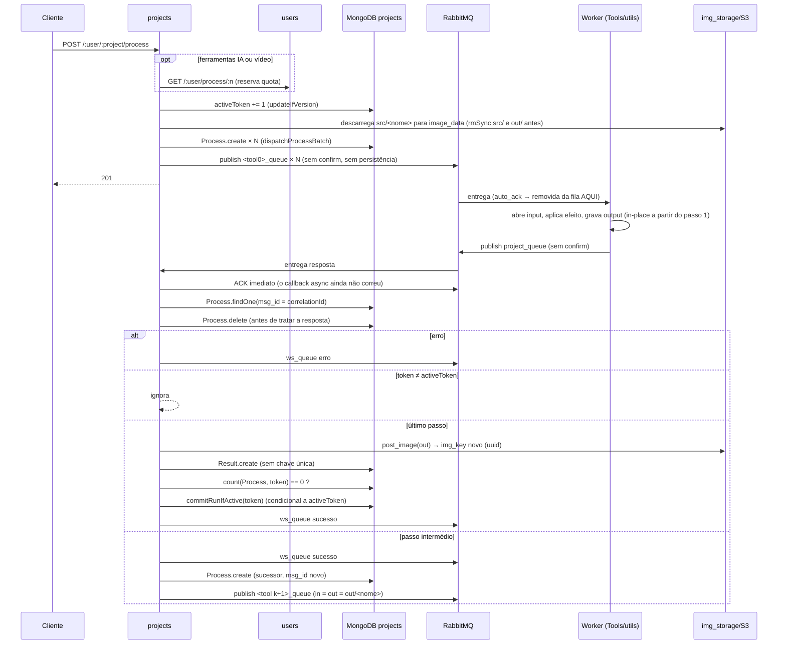

# RNF-FIAB-01 — Diagnóstico do fluxo de processamento de imagens

Base analisada: `main` @ `df5d0bc2a53ba8fb677987e2e1d69e939017418a`. Análise estática do
código do repositório e do código do worker de watermark lido dentro do contentor
`prcsousa/picturas-watermark-tool-ms` (digest `sha256:534007b3…5835`). As janelas inferidas do
código foram depois medidas na baseline (§7). A §8 relaciona esta numeração com o diagnóstico
do relatório da Pessoa 2.

## 1. Contratos de mensagens: produtores e consumidores

Todas as filas são *classic*, duráveis, ligadas ao exchange direto durável `picturas`
(`rabbitMQ/definitions.json`). Nenhum produtor marca mensagens como persistentes nem usa
*publisher confirms*.

| Fila / contrato                    | Produtores                                                                                                                | Consumidores                                                                  | Modo de ACK do consumidor                                                                 |
| ---------------------------------- | ------------------------------------------------------------------------------------------------------------------------- | ----------------------------------------------------------------------------- | ----------------------------------------------------------------------------------------- |
| `<tool>_queue` (pedido)            | `projects`: `POST /:user/:project/process` (passo 0), `process_msg` (passo k+1), `POST …/preview/:img` — via `send_msg_tool` (`projects/utils/project_msg.js:26`) | 8 workers PIL e 7 de IA via `Tools/utils` (`ToolMSG.read_msg`)                 | `auto_ack=True` (`Tools/utils/rabbit_mq.py:40`) — ACK na entrega                          |
| `watermark_queue` (pedido)         | idem                                                                                                                      | worker externo `watermark_tool_ms` (não declara filas; usa as das definições) | ACK manual, **depois** de agendar a resposta (`core/message_processor.py:93-98`), `prefetch=4`, *heartbeat* 5 s, 1 *thread* por mensagem |
| `video_queue` (pedido)             | idem (uma mensagem por vídeo com o pipeline inteiro)                                                                      | `video_tool` (`Tools/video/video.py`)                                          | ACK manual no fim (`video.py:170`), `prefetch=1`, `heartbeat=0`                           |
| `project_queue` (resposta)         | `Tools/utils/tool_msg.py:41-87`, `video.py:_reply_*`, watermark `send_response_message`                                    | `projects` `process_msg` (`routes/projects.js:168`)                           | ACK manual mas **imediato**, antes de a promessa do *callback* terminar (`projects/utils/rabbit_mq.js:46-51`); sem `prefetch` |
| `ws_queue` (notificação)           | `projects` (`send_msg_client*`, `send_msg_project_op`), `video_tool` (progresso)                                          | `wsGateway` (`wsGateway/utils/rabbit_mq.js:72-80`)                            | ACK após o *callback* síncrono                                                            |

### Formato do pedido (`send_msg_tool`)

```json
{ "messageId": "request-<uuid> | preview-<uuid>", "timestamp": "<ISO>", "procedure": "<tool>",
  "parameters": { "inputImageURI": "./images/…", "outputImageURI": "./images/…", "...": "params" } }
```

`messageId` é aleatório por despacho. O orquestrador distingue *preview* por regex `/preview/`
sobre o `messageId`.

### Formato da resposta

| Produtor            | Sucesso                                                             | Erro                                                                                                              |
| ------------------- | ------------------------------------------------------------------- | ----------------------------------------------------------------------------------------------------------------- |
| `Tools/utils`       | `messageId=<tool>-<n>-<req>`, `correlationId=<req>`, `output.{type,imageURI}` | `messageId=<req>`, `correlationId=<tool>-<n>-<req>` (**trocados**, `tool_msg.py:66-67`), `error.{code,message}` |
| `video_tool`        | `correlationId=<req>`, `output.{type,imageURI[,frames]}`            | `correlationId=<req>`, `error.{code,message,msg}`                                                                 |
| watermark externo   | `messageId=completion-<req>`, `correlationId=<req>`                 | `correlationId=<req>`, `error.{code,description}` (sem `msg`)                                                     |

O único consumidor de `project_queue` é `projects`, que procura o `Process` por
`correlationId` e lê `error.code`/`error.msg`.

## 2. Estado persistido

| Coleção / ficheiro                     | Campos relevantes                                                                                                         | Índices/unicidade |
| -------------------------------------- | ------------------------------------------------------------------------------------------------------------------------- | ----------------- |
| `project`                              | `activeToken` (execução em curso), `committedToken`/`resultsToken` (execução visível), `prevCommittedToken/Tools`, `pendingAdvancedOps`, `chargedAdvancedTools`, `version` | `_id`             |
| `process` (1 por passo em curso)       | `project_id`, `img_id`, `msg_id`, `cur_pos`, `og_img_uri`, `new_img_uri`, `token`, `runner_id`, `cache_key`, timestamps     | **nenhum** além de `_id` (nem em `msg_id`) |
| `result`                               | `project_id`, `img_id`, `token`, `type`, `file_name`, `img_key`                                                            | índice simples em `token`; **sem unicidade** |
| `users.operations[]`                   | `{day, processed}` por dia                                                                                                 | —                 |
| Volume `image_data`                    | `src/<nome>` (cópia local do original, descarregada em cada `POST /process`), `out/<nome>` (**um único ficheiro, reescrito por todos os passos**) | —                 |
| SeaweedFS (`img_storage`)              | `src/` (original, imutável), `out/<uuid>.<ext>` (um objeto novo por cada `post_image`)                                     | chave aleatória   |

## 3. Ciclo de vida atual de uma execução de imagens



Observações estruturais:

- **Encadeamento in-place.** Para `k ≥ 1`, `inputImageURI == outputImageURI == out/<nome>`
  (`routes/projects.js:494-495`). Um passo reexecutado lê a sua própria saída.
- **Ordem destrutiva no orquestrador.** O `Process` é apagado (`:208`) antes de o resultado ser
  persistido (`:420`) ou de o sucessor ser criado (`:514`). O "contador" de trabalhos pendentes
  é o número de documentos `Process` do token.
- **Concorrência.** `amqplib` sem `prefetch` entrega todas as respostas de imediato; os
  *callbacks* `async` correm intercalados. Não há serialização por projeto.
- **Quota.** Só `POST /process` cobra (ferramentas IA + efeitos de vídeo). Os workers e o
  `process_msg` nunca cobram; o cancelamento devolve `pendingAdvancedOps`.

## 4. Janelas de falha

Legenda de efeitos: **P** perda (trabalho nunca conclui; o lote não consolida), **D** resultado
duplicado publicado, **A** reaplicação de efeito, **C** consolidação prematura/incompleta,
**S** sobrescrita da execução ativa por tentativa antiga, **X** cobrança adicional.

### 4.1 Worker (`Tools/utils`)

| ID  | Janela                                                       | Comportamento atual                                                                                                                                                       | Efeito | Cenário |
| --- | ------------------------------------------------------------ | ------------------------------------------------------------------------------------------------------------------------------------------------------------------------- | ------ | ------- |
| W1  | Entregue, antes de produzir saída                           | `auto_ack`: o broker já apagou o pedido. Morte do worker → nenhuma reentrega, `Process` fica para sempre.                                                                  | P      | R1      |
| W2  | Durante a escrita do ficheiro                               | `Image.save` escreve diretamente no destino → ficheiro truncado. Sem reentrega. No passo ≥ 1 o ficheiro de entrada (o mesmo) fica **corrompido**.                        | P (+ corrupção) | R2 |
| W3  | Saída escrita, antes de publicar a resposta                 | Sem reentrega. Se houvesse reentrega, no passo ≥ 1 o efeito seria aplicado sobre a própria saída.                                                                         | P (A latente) | R3 |
| W4  | Resposta publicada, antes do ACK do pedido                  | Com `auto_ack` a janela não existe (o ACK foi na entrega). A publicação não é confirmada: morrer logo após `basic_publish` pode perder a resposta ainda no *buffer* (não observado na baseline, §7). | P (raro) | R4 |
| W5  | Erro permanente (imagem inválida, parâmetro inválido)       | Os workers simples chamam `send_msg` com argumentos desalinhados (ex. `brightness.py:63-73`, `resize.py:52,69`): `og_img_uri=None` → `tool_msg.py:62-63` lança exceção e **nenhuma resposta sai**. Mesmo quando sai, `correlationId` está trocado e o `Process` não é encontrado. O ciclo `while True: read_msg` volta a registar o consumidor no mesmo canal (confirmado na baseline, §7). | P | R8 |
| W6  | Broker reinicia com mensagens em fila                       | Mensagens não persistentes perdem-se mesmo em filas duráveis.                                                                                                             | P      | (exclusão parcial, ver §6) |
| W7  | Processamento longo (IA) com ACK manual futuro              | `BlockingConnection` com *heartbeat* por omissão bloqueado durante o efeito → o broker fecha a ligação e reentrega enquanto o worker ainda corre. Hoje mascarado pelo `auto_ack`. | A/D (risco da solução) | — |

### 4.2 Watermark externo

| ID  | Janela                                   | Comportamento atual                                                                                                         | Efeito |
| --- | ---------------------------------------- | --------------------------------------------------------------------------------------------------------------------------- | ------ |
| X1  | Morte antes do ACK                       | Reentrega pelo broker (ACK manual). Em passo ≥ 1, a reentrega lê o ficheiro já marcado → marca aplicada duas vezes.         | A      |
| X2  | Resposta publicada, ACK perdido          | Reentrega → segunda execução e segunda resposta com o mesmo `correlationId`.                                                | A + D (via W/P2) |
| X3  | Erro                                     | `error.description` em vez de `error.msg` → o utilizador recebe mensagem `undefined`, mas o `Process` é encontrado.         | —      |

### 4.3 Orquestrador (`projects`)

| ID  | Janela                                                                       | Comportamento atual                                                                                                                                                                                       | Efeito | Cenário |
| --- | ---------------------------------------------------------------------------- | --------------------------------------------------------------------------------------------------------------------------------------------------------------------------------------------------------- | ------ | ------- |
| P1  | Resposta entregue → morte de `projects` em qualquer ponto do *callback*      | O ACK já foi enviado (`rabbit_mq.js:50`). A resposta perde-se; o `Process` pode já ter sido apagado (morte após `:208`) ou não.                                                                           | P      | R6      |
| P2  | Respostas duplicadas sequenciais (mesmo `correlationId`)                     | A primeira apaga o `Process`; a segunda não o encontra e é ignorada.                                                                                                                                      | —      | R5      |
| P3  | Respostas duplicadas concorrentes                                            | Ambas encontram o `Process` antes do `delete`. No último passo: dois `post_image` (duas chaves) e dois `Result.create` → **dois resultados publicados** para a mesma media. Em passo intermédio: dois sucessores com `msg_id` diferentes → dois pedidos ao mesmo ficheiro in-place → **efeito reaplicado** e, depois, novamente dois resultados. | D, A | R5 |
| P4  | Morte entre `Process.delete` (`:208`) e `Process.create` do sucessor (`:514`) | O passo k está concluído mas o k+1 nunca é registado nem publicado. Se for o último trabalho pendente do token, o lote fica sem consolidação.                                                             | P      | R6      |
| P5  | Morte entre `Process.create` do sucessor e `send_msg_tool`                   | Sucessor registado mas nunca publicado: barreira eterna, lote nunca consolida.                                                                                                                            | P      | R6      |
| P6  | Publicação do sucessor perdida (sem confirm; ligação fechada aos 500 ms; `throw` dentro do *callback* derruba o processo) | Idem P5.                                                                                                                                                                         | P      | R6      |
| P7  | Último passo: `post_image` feito, morte antes de `Result.create`             | Objeto órfão em S3; resultado perdido; lote nunca consolida (se for o último) ou **consolida sem este resultado** (ver P8).                                                                                | P / C  | R6      |
| P8  | Corrida entre trabalhos do mesmo token                                       | O trabalho A apaga o seu `Process` (`:208`) e começa o *upload*; o trabalho B termina, conta `remaining == 0` e consolida **antes** de o `Result` de A existir. O cliente é notificado com o lote incompleto; o resultado de A aparece mais tarde no token já consolidado. | C | R0 (sob concorrência), R6 |
| P9  | Morte entre `Result.create` e `commitRunIfActive`                            | Todos os resultados persistidos, mas ninguém volta a contar → `committedToken` nunca avança.                                                                                                               | P (do lote) | R6 |
| P10 | Erro de um trabalho (resposta `error`)                                       | O `Process` é apagado; se os restantes terminarem, o lote é **consolidado com resultados em falta** (não há estado "falhado").                                                                              | C      | R8      |
| P11 | `Process` de *preview* com o mesmo `token` do lote em curso                  | `countByProjectAndToken` conta-o: um *preview* pendente atrasa a consolidação do lote; um *preview* perdido bloqueia-a.                                                                                   | P (lateral) | — |
| P12 | Exceção no *callback* (ex. `post_image` falha transitoriamente)             | `catch` envia erro ao cliente; mensagem já confirmada; `Process` já apagado → trabalho perdido sem nova tentativa.                                                                                        | P      | — |

### 4.4 Cancelamento, nova execução e respostas tardias

| ID  | Janela                                                                                 | Comportamento atual                                                                                                                                                                                                   | Efeito | Cenário |
| --- | -------------------------------------------------------------------------------------- | --------------------------------------------------------------------------------------------------------------------------------------------------------------------------------------------------------------------- | ------ | ------- |
| K1  | Resposta da execução cancelada chega depois do cancelamento                            | `DELETE …/process` apaga todos os `Process` → a resposta é ignorada. Correto.                                                                                                                                          | —      | R7      |
| K2  | Resposta antiga chega depois de uma **nova** execução ter começado                    | O `Process` antigo já não existe → ignorada. Correto quanto ao estado.                                                                                                                                                 | —      | R7      |
| K3  | Worker da execução antiga ainda a escrever quando a nova execução começa              | A nova execução faz `rmSync(out/)` e reutiliza **os mesmos caminhos**; o worker antigo escreve `out/<nome>` por cima do ficheiro da execução ativa (ou o worker novo lê um ficheiro em escrita).                      | S, A   | R7      |
| K4  | `DELETE …/tool/:tool` (undo) com execução em curso                                     | Apaga todos os `Process` mas **não** incrementa `activeToken`: a execução fica ativa sem trabalhos, as respostas são ignoradas e o lote nunca consolida.                                                               | P (lateral) | — |
| K5  | Quota                                                                                  | Reservada no `POST /process`; devolvida no cancelamento se `pendingAdvancedOps > 0`. Nenhuma janela de cobrança dupla por reentrega; risco apenas se a recuperação reenviar `POST /process`.                            | (X evitável) | R0, R7 |

## 5. Corridas e invariantes violáveis hoje

1. **"Um resultado por media e execução"** — violado por P3 (duplicados concorrentes) e por
   reexecuções futuras se a reentrega for ativada sem idempotência.
2. **"Cada efeito aplicado exatamente uma vez à saída"** — violado por qualquer reexecução de um
   passo ≥ 1 (encadeamento in-place): X1, X2, P3, e qualquer reentrega futura em W2/W3/W4.
3. **"Consolidar só com todos os resultados persistidos"** — violado por P8 e P10.
4. **"Tentativa antiga não afeta a execução ativa"** — o estado está protegido por `token`, mas
   os ficheiros não (K3).
5. **"Original intacto"** — o objeto S3 `src/` nunca é escrito pelos workers; a cópia local
   `src/<nome>` só é lida (passo 0). A corrupção possível (W2) atinge `out/`, não o original.

## 6. Pressupostos e exclusões do diagnóstico

- RabbitMQ e MongoDB não perdem dados confirmados (disco persistente, nó único). Perda de disco
  do broker ou do MongoDB está fora do âmbito.
- `img_storage`/SeaweedFS disponível; as suas falhas são tratadas como erros transitórios do
  orquestrador (P12), não como objeto deste requisito.
- O watermark externo não pode ser alterado; só a forma como o orquestrador o invoca.
- Vídeo: o `video_tool` já faz ACK no fim e deixa a saída intacta em caso de falha; o seu
  tratamento em `projects` partilha as janelas P1–P12 e beneficiará das alterações do
  orquestrador, mas a reexecução de vídeo não é medida por este requisito.

## 7. Confirmação empírica (baseline)

Medido sobre a versão original com o protocolo de [protocolo-baseline.md](protocolo-baseline.md);
detalhe em [resultados-baseline.md](resultados-baseline.md) §2.

| Janela | Cenário | Resultado |
| --- | --- | --- |
| W1–W3 | R1–R3 | Confirmado. O trabalho alvo perde-se em 10/10 e, com ele, 4–5 trabalhos de outras imagens que o worker tinha em *prefetch* (perda colateral de W1). O lote fica pendurado. |
| W4 | R4 | Não observado: o trabalho alvo concluiu em 10/10. O lote não consolida, mas pela perda colateral de W1. |
| W5 | R8a, R8b | Confirmado. Erro notificado em 0/20. Em R8a o worker do border sobrevive e volta a consumir, perdendo as mensagens em *buffer* (5–6 trabalhos válidos); em R8b o worker do brightness termina. |
| P3 | R5a, R5b | Confirmado com cópias concorrentes: 2 `Result` duplicados por repetição em R5a; cadeias paralelas, reaplicações e um resultado vazio em R5b. Cópias sequenciais (P2) são ignoradas (R5c). |
| P1, P4, P5, P7, P9 | R6a–e | Confirmado. A resposta em tratamento e as que estavam em *prefetch* perdem-se; em R6e os 10 resultados ficam gravados e o lote nunca consolida. |
| P8 | R6b, R6d | Confirmado: lotes consolidados com 7–9 resultados (3 repetições em R6b, 1 em R6d). |
| K3 | R7 | Confirmado: em média 4,4 imagens por lote com o efeito reaplicado, incluindo o `img03` em 10/10. |

## 8. Correspondência com o diagnóstico da Pessoa 2

O relatório da Pessoa 2 (`benchmarks/fault-tolerance/RELATORIO-RNF-FIAB-01.md` §1) numerava as
fragilidades D1–D8. Não são as decisões de desenho D1–D8 de
[especificacao-e-decisao.md](especificacao-e-decisao.md) §6. A Pessoa 1 reviu essa lista contra
este diagnóstico, e o relatório passou a usar a numeração W/X/P/K e M1–M12 daqui.

| Pessoa 2 | Janelas | Notas da revisão |
| --- | --- | --- |
| D1 `auto_ack=True` nos workers | W1 | Inclui a perda colateral das mensagens em *prefetch* (R1–R4). |
| D2 escrita direta e mesmo ficheiro a partir da 2.ª etapa | W2, W3, K3 | Reaplicação medida em R5b e R7. |
| D3 `messageId`/`correlationId` trocados e argumentos desalinhados | W5, X3 | Confirmado em R8a/R8b (§7). |
| D4 `projects` confirma antes de tratar | P1, P12 | Uma exceção transitória no *callback* também perde o trabalho (P12). |
| D5 avanço de etapa não atómico | P4–P7, P8 | P8: apagar o `Process` antes de gravar o resultado permite consolidar sem ele. |
| D6 sem idempotência nas respostas | P2, P3 | Só cópias concorrentes (P3) duplicam; as sequenciais (P2) são ignoradas. |
| D7 sem *confirms* nem persistência; uma ligação por mensagem no Node | W4, W6, P6 | A falha do broker não é cenário medido, mas a correção cobre-a. |
| D8 cancelamento não interrompe os workers e reutiliza caminhos | K3 | K1 e K2 estão corretos. |
| (em falta) | P9, P10, P11, K4, W7, X1–X3 | Acrescentados na revisão: consolidação nunca feita (P9), resposta de erro que apaga o `Process` (P10), *preview* com o mesmo token (P11), *undo* sem novo token (K4), *heartbeats* com efeitos longos (W7) e watermark externo (X1–X3). |
